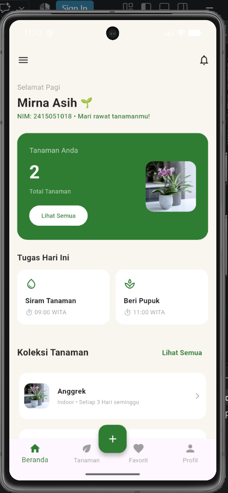
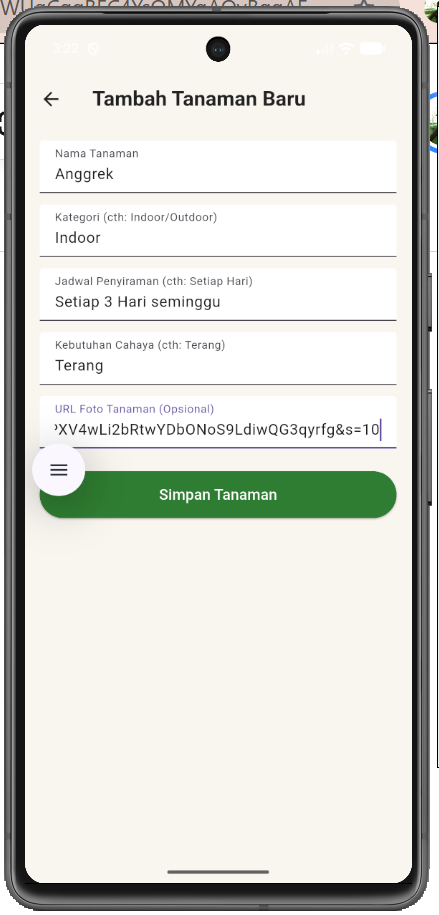
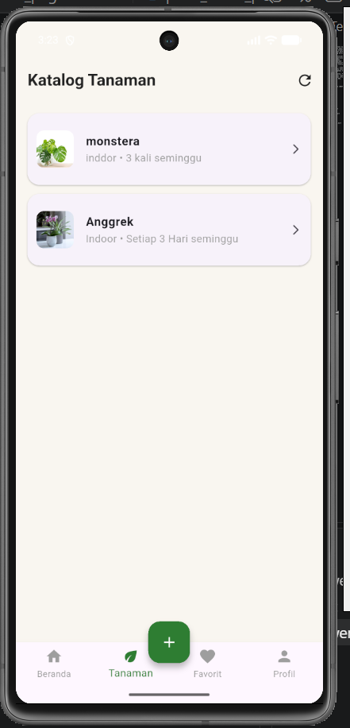
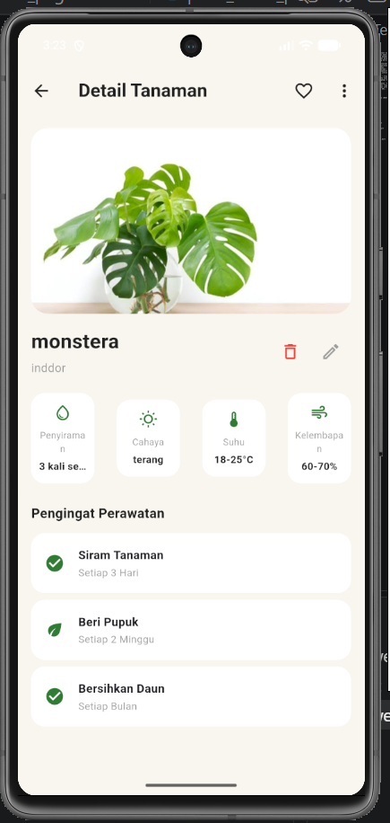
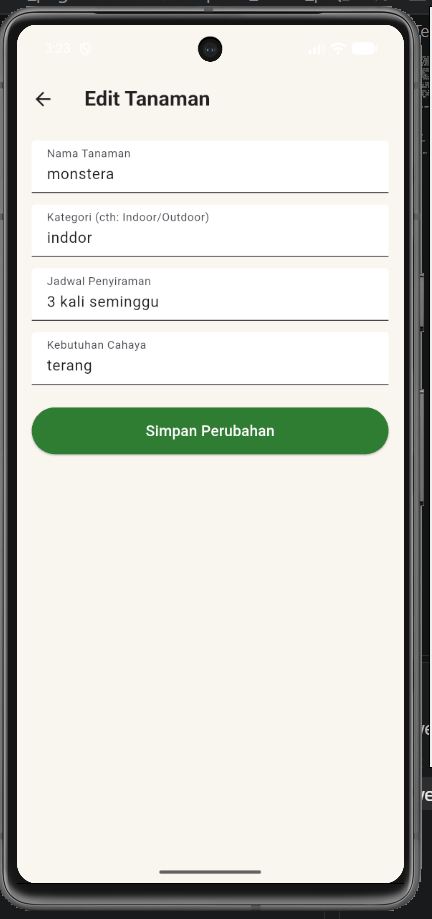
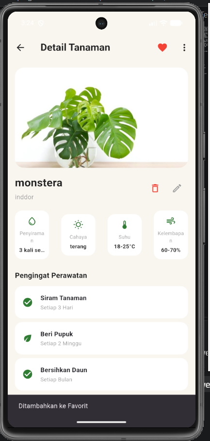
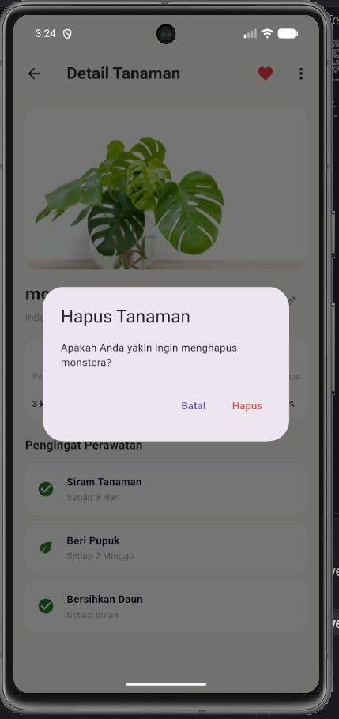
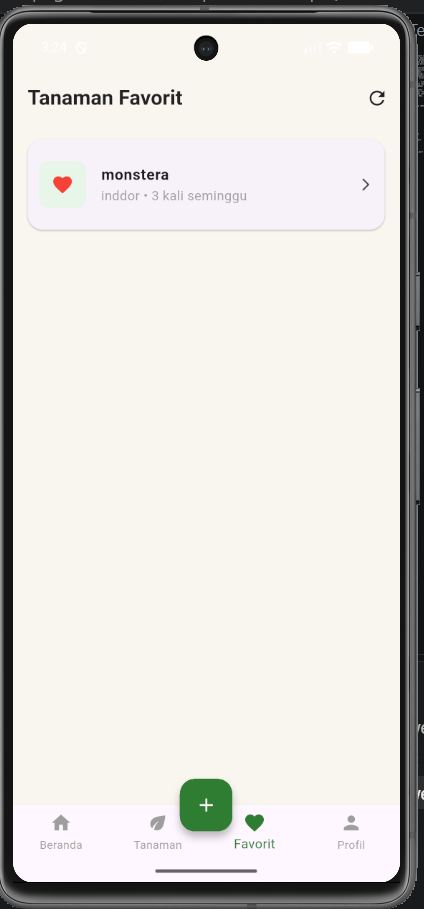
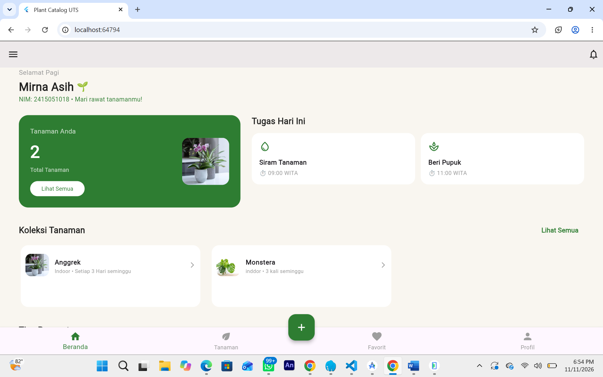
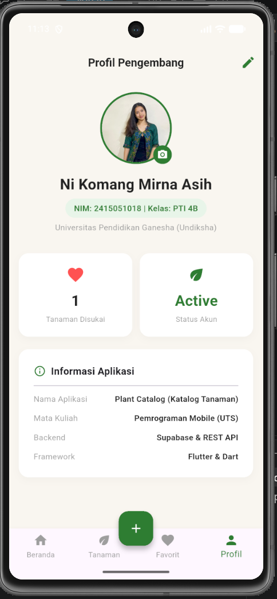

Nama: Ni Komang Mirna Asih  
 NIM: 2415051018   
 Kelas: PTI 4B / Semester 5

🌿 Aplikasi Katalog Tanaman (Plant Catalog)
Katalog Tanaman adalah aplikasi mobile berbasis Flutter yang dirancang untuk memudahkan pengguna dalam mengelola, memantau, dan mendata berbagai jenis tanaman secara digital. Aplikasi ini dibangun dengan mengintegrasikan backend cloud modern menggunakan Supabase serta menerapkan arsitektur perangkat lunak yang bersih dan terstruktur (Layered Architecture).

📱 Daftar Fitur UtamaBeranda Interaktif 
1. (Home): Menampilkan sapaan personal, total tanaman dinamis yang terhubung ke database, serta kartu informasi perawatan tanaman.   
2. Katalog Tanaman (List & Catalog): Menampilkan daftar seluruh tanaman yang tersimpan dengan pencarian dan navigasi yang responsif.   
3. Detail Tanaman: Menampilkan informasi spesifik tanaman dengan tombol aksi interaktif serta fitur Favorite.   
4. Tambah & Edit Tanaman (CRUD - Create & Update): Formulir lengkap dengan validasi input untuk memasukkan atau memperbarui data tanaman beserta gambar/foto.  
5.  Hapus Data (Delete): Dilengkapi dengan dialog konfirmasi (confirmation dialog) sebelum menghapus data dari database.   
6. Error Handling & Loading States: Penanganan status loading serta widget kustom Error View interaktif lengkap dengan tombol "Coba Lagi" (Retry).   
7. Profil Mahasiswa: Menampilkan informasi identitas lengkap serta fitur interaktif untuk mengubah foto profil menggunakan tautan URL.   

📱 Teknologi yang Digunakan
1. Framework: Flutter & Dart
2. State Management: Provider
3. Backend & Database: Supabase (REST API)
4. Version Control: Git & GitHub

REST API & DatabaseLayanan REST API 
 1. Backend: Supabase Client SDK (supabase_flutter)   
 2. Tabel Database Utama: saved_plants (menyimpan kolom id, name, category, watering_schedule, image_url, is_favorite, dll.)   
 3. Operasi CRUD: Sepenuhnya terimplementasi (Create, Read, Update, Delete).   

Struktur Arsitektur Aplikasi
lib/
├── models/
│   └── plant.dart
    └── plant_task.dart
└── providers
    └── plant_providers.dart
├── repositories/
│   └── plant_repository.dart
├── screens/
│   ├── home_page.dart
│   ├── plant_catalog_page.dart
│   ├── plant_detail_page.dart
│   ├── add_plant_page.dart
│   ├── favorite_plants_page.dart
│   └── profile_page.dart
    └── edit_plant_page.dart
    └── main_navigation.dart
└── services
    └── plant_api_service.dart
    └── plant_supabase_service.dart
├── widgets/
│   └── error_view.dart
└── main.dart

Cara Menjalankan Project:

Pastikan Anda telah menginstal Flutter SDK, Git, serta menyiapkan emulator atau perangkat fisik (Android/iOS) sebelum menjalankan langkah-langkah berikut:

Kloning repository project ini ke komputer lokal Anda menggunakan tautan repository GitHub Anda.

Buka folder project melalui terminal atau buka langsung foldernya menggunakan aplikasi VS Code.

Buka file pada direktori lib/main.dart dan pastikan URL serta Anon Key dari project Supabase Anda sudah terisi dengan benar pada fungsi inisialisasi Supabase.

Jalankan perintah pengambilan pustaka (dependencies) Flutter untuk mengunduh seluruh package yang dibutuhkan ke dalam project.

Pilih perangkat target (emulator atau HP fisik), lalu jalankan perintah untuk memulai dan meluncurkan aplikasi.